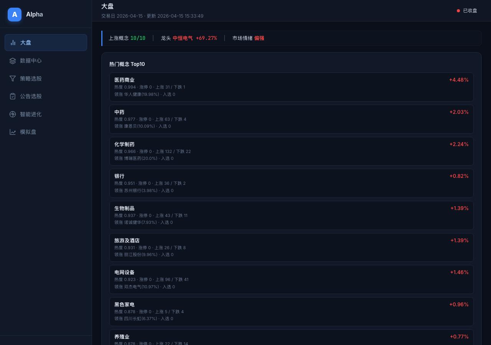
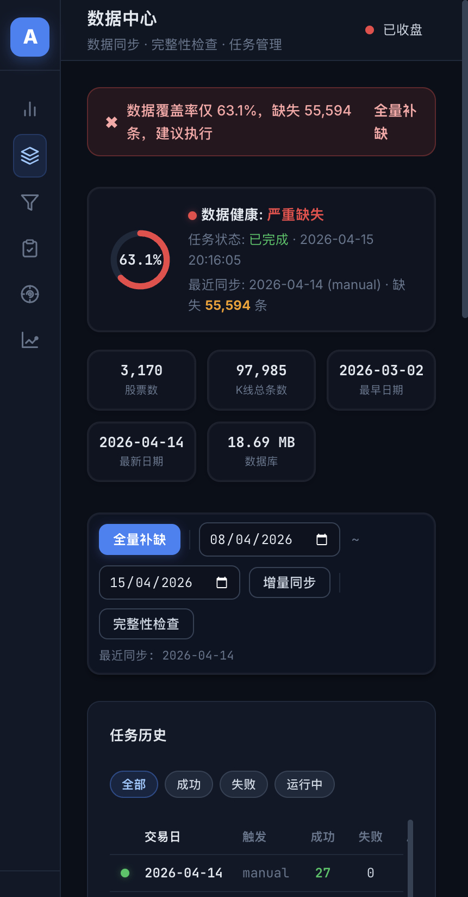
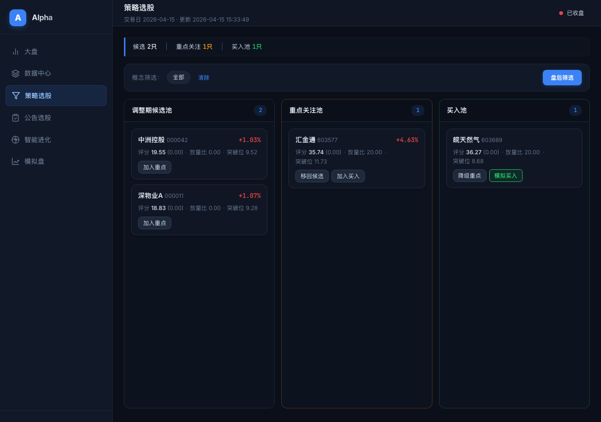
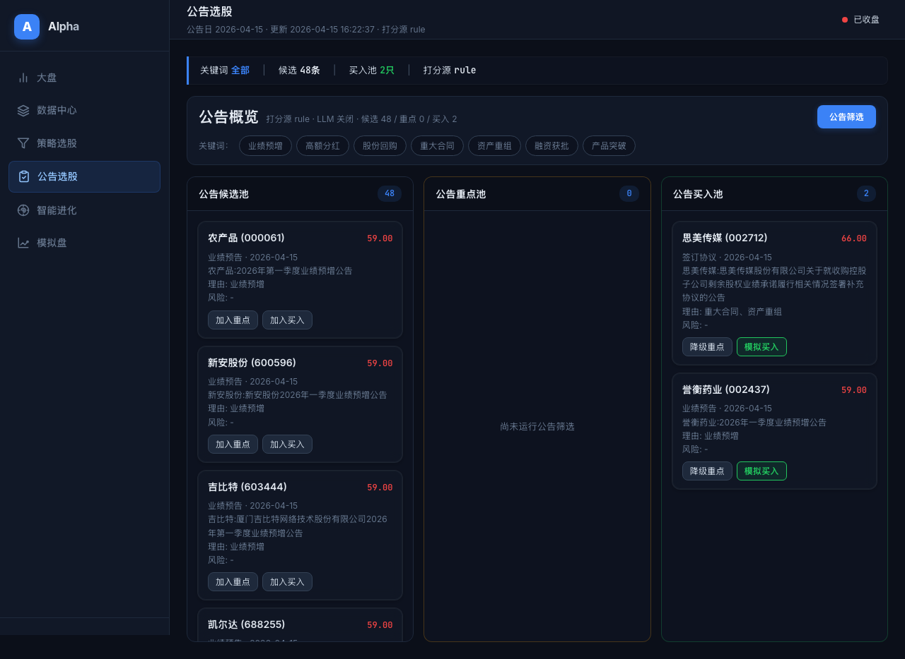
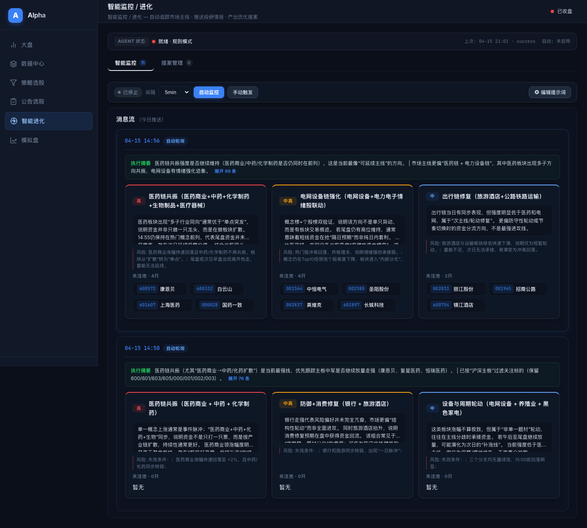
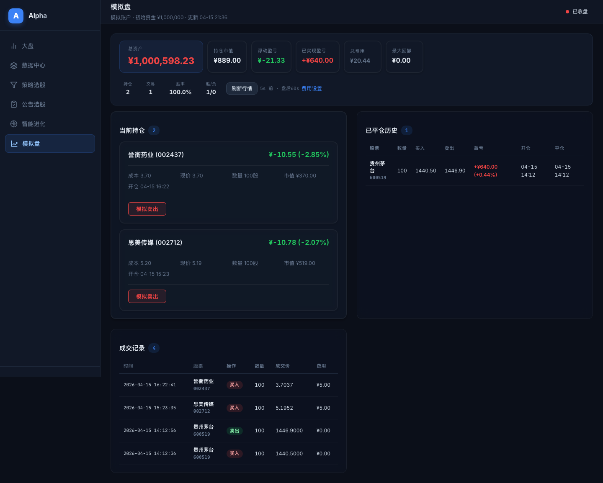
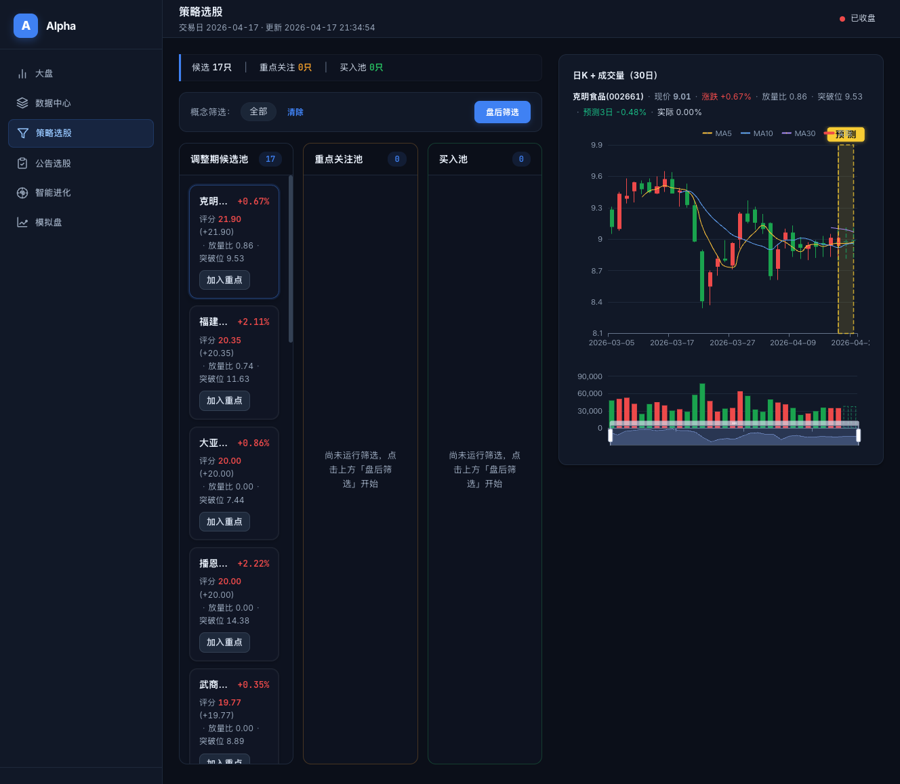

# Alpha — Self-Evolving Quantitative Stock Screening

<p align="center">
  <strong>A-share quant screening · Kronos K-line foundation model · Hermes Agent self-evolution loop</strong><br>
  <em>A 股量化选股 · Kronos K线预测模型 · Hermes Agent 自进化闭环</em>
</p>

<p align="center">
  <a href="https://github.com/Shadowell/Alpha/stargazers"></a>
  <a href="https://github.com/Shadowell/Alpha/network/members"></a>
  <a href="https://github.com/Shadowell/Alpha/actions/workflows/tests.yml"></a>
  <a href="https://github.com/Shadowell/Alpha/releases/latest"></a>
  <a href="LICENSE"></a>
  
</p>

<p align="center">
  <a href="#english-overview">English</a> ·
  <a href="#中文简介">中文</a> ·
  <a href="#快速开始">Quick Start</a> ·
  <a href="CONTRIBUTING.md">Contributing</a> ·
  <a href="SECURITY.md">Security</a> ·
  <a href="https://github.com/Shadowell/Alpha/issues/new/choose">Report Issue</a>
</p>

## English Overview

**Alpha** is an open-source, self-evolving quantitative stock screening system for the Chinese A-share market. It combines the **[Kronos](https://arxiv.org/abs/2508.02739) financial K-line foundation model** with a **Hermes Agent** loop so the system can observe the market, reason about themes, validate signals, and improve over time.

| Capability | What you get |
|---|---|
| Three-pool funnel screening | Intraday scoring + promotion / demotion rules for candidate stocks |
| Kronos prediction | K-line forecast inference integrated into the research UI and APIs |
| Hermes Agent + MCP | Scheduled post-market review, announcement review, and live monitoring |
| Paper trading | Simulated execution for strategy validation without live capital |
| FastAPI + Web UI | 50+ REST endpoints, WebSocket snapshots, and an 8-tab dark dashboard |

**Why it matters for the OSS ecosystem:** most open quant stacks are US/crypto-centric. Alpha fills a practical gap for A-share research—local data pipelines, LLM-agent workflows, and reproducible screening loops that researchers and builders can fork, audit, and extend under MIT.

```bash
# Quick start (Docker, recommended)
cp .env.example .env   # optional: add Tushare / LLM keys (all can stay empty)
docker compose up -d   # http://127.0.0.1:18888

# Or run from source (API / data runtime)
python3 -m venv .venv && source .venv/bin/activate
pip install -r requirements-base.txt
cp .env.example .env   # add Tushare / LLM keys as needed
./start.sh             # http://127.0.0.1:18890
```

Full install options, API map, and architecture details are below. Contributions welcome — see [CONTRIBUTING.md](CONTRIBUTING.md).

## 中文简介

Alpha 是一个面向 A 股市场的**自进化量化选股系统**。它不只是一个筛选工具——通过集成 **[Kronos](https://arxiv.org/abs/2508.02739) 金融 K 线基础模型**和 **Hermes Agent 自进化智能体**，Alpha 能够自主观察市场、分析主线、输出结构化诊断与交易建议，形成**观察 → 思考 → 校验 → 进化**的持续优化闭环。

欢迎通过 [Issue](https://github.com/Shadowell/Alpha/issues/new/choose) / [PR](https://github.com/Shadowell/Alpha/pulls) 参与贡献，详见 [CONTRIBUTING.md](CONTRIBUTING.md)。

---

## 系统架构

```
┌──────────────────────────────────────────────────────────────────────┐
│                         Alpha 系统架构                               │
│                                                                      │
│  ┌─────────────┐    ┌─────────────────────────────────────────────┐  │
│  │  数据层      │    │                 服务层                       │  │
│  │             │    │                                             │  │
│  │  Tushare Pro│───▶│  KlineCacheService    K线并发同步            │  │
│  │  东财/新浪  │───▶│  MarketDataClient     主源降级/实时行情      │  │
│  │  同花顺     │───▶│  ConceptEngine        概念热度评分           │  │
│  │  AkShare    │───▶│  StrategyEngine       盘中实时评分           │  │
│  │             │    │  NoticeService        公告抓取+双引擎打分     │  │
│  └─────────────┘    │  FunnelService        三池漏斗状态管理       │  │
│                     │  PaperTradingService   模拟交易引擎           │  │
│  ┌─────────────┐    │                                             │  │
│  │  存储层      │    │  KronosPredictService  K线预测推理           │  │
│  │             │    │  HotStockAIService     热门股智能分析        │  │
│  │             │    │  HermesRuntime         Agent调度+LLM推理     │  │
│  │  SQLite ×3  │◀──▶│  HermesMemory          任务/监控记忆持久化  │  │
│  │  市场K线    │    │  JobStore/Manager      长任务队列与进度       │  │
│  │  漏斗状态   │    │                                             │  │
│  │  任务队列   │    │                                             │  │
│  └─────────────┘    └───────────────┬─────────────────────────────┘  │
│                                     │                                │
│  ┌─────────────┐    ┌───────────────▼─────────────────────────────┐  │
│  │  Kronos     │    │               接口层                         │  │
│  │  (102.3M)   │    │                                             │  │
│  │  K线基础    │◀──▶│  FastAPI REST API（84 条路由，领域 Router）    │  │
│  │  模型       │    │  /api/health + /api/metrics + 请求 ID        │  │
│  └─────────────┘    │  WS /ws/realtime · MCP Server (20+ tools)    │  │
│                     │                                             │  │
│  ┌─────────────┐    └───────────────┬─────────────────────────────┘  │
│  │  Hermes     │                    │                                │
│  │  Agent      │◀──MCP协议──────────┘                                │
│  │  (LLM)      │                                                     │
│  └─────────────┘    ┌─────────────────────────────────────────────┐  │
│                     │               前端层                         │  │
│  ┌─────────────┐    │                                             │  │
│  │  飞书通知    │◀───│  原生HTML/CSS/JS + ECharts 5                 │  │
│  │  Webhook    │    │  8 Tab 单页应用 · Glassmorphism 暗色主题      │  │
│  └─────────────┘    │  10s 实时轮询 + WebSocket 双通道推送          │  │
│                     └─────────────────────────────────────────────┘  │
└──────────────────────────────────────────────────────────────────────┘
```

### 后台调度引擎

系统启动后由服务容器统一管理 7 个后台循环和 1 个启动回填任务（`/api/health` 会逐项检查其存活状态）：

| 循环 | 频率 | 职责 |
|------|------|------|
| **启动回填** | 一次性 | 补齐缺失的股票名称并刷新本地 symbol name cache |
| **Ticker Loop** | 60s | 调用 `FunnelService.tick()` 刷新漏斗评分，变更时 WebSocket 广播快照 |
| **K线同步 Loop** | 每日 15:20 | 自动检测是否需要同步，仅补最新交易日缺口，进度写入数据中心 |
| **分钟线 Loop** | 60s | 交易时段仅为买入池标的同步 1 分钟 K 线，非交易时段空转 |
| **Hermes 调度 Loop** | 300s | 15:30 盘后复盘 · 21:00 公告复盘 |
| **智能监控 Loop** | 30s | 盘中按配置间隔（5~30min）执行 LLM 监控 tick，结果 WebSocket 推送 |
| **预测选股 Loop** | 300s 检查 | 交易日 16:15 自动触发预测选股扫描，同日只跑一次 |
| **热门智能 Loop** | 60s 检查 / 5min 执行 | 检查热门股票智能分析是否过期，按配置自动刷新 Top20 个股，并对前排标的触发 TradingAgents 多代理讨论 |

---

## 界面预览

### 1. 大盘总览

> 一眼掌握市场情绪和热点方向。



- **市场情绪面板**：上涨概念占比、龙头股涨幅、市场情绪等级（偏强/中性/偏弱）
- **热门概念 Top10**：按热度排序，展示涨停/上涨/下跌家数、领涨个股、漏斗入选数
- **热门个股 Top30**：展示最新价、当日涨幅和 10 日累计涨幅，点击可弹出 K 线 + Kronos 预测叠加图
- **实时双通道**：10s 轮询 + WebSocket 服务端主动推送

### 2. 数据中心

> K 线数据的健康管理中枢，保障策略运行的数据基础。



- **健康仪表盘**：环形图展示覆盖率百分比 + 健康等级
- **KPI 指标卡**：股票数、K 线总条数、最早/最新日期、数据库大小
- **同步操作**：全量补缺（日期×股票交叉补全）· 增量同步（日期范围一次提交批量队列）· 完整性检查
- **任务历史**：分页展示，支持按状态筛选（全部/成功/失败/运行中）
- **完整性报告**：按日期展示缺失分布，最差个股排名
- **自动同步**：每日 15:20 自动补最新交易日缺口；配置 Token 时以 Tushare 提供股票主数据、交易日历和日线，未配置或调用失败时显式降级东财 / 新浪；实时行情固定走东财，历史全量补缺仅由手动按钮触发
- **数据增强**：日线封账后按交易日增量同步估值/换手/量比/市值、涨跌停价、复权因子、个股资金流、北向资金和 4 个基准指数；盘中每分钟同步买入池分钟线（仅买入池，不做全市场实时）
- **增强覆盖面板**：数据中心展示每类增强数据的最新日期、行数与同步状态，失败数据集独立标记，不影响主 K 线封账
- **来源可追溯**：K 线与同步明细持久化 `source` / `fallback_reason`，可区分 `tushare`、`eastmoney`、`sina`、`sqlite` 与具体降级原因

### 数据源与格式

| 场景 | 主源 | 降级源 | Alpha 内部格式 |
|------|------|--------|----------------|
| 股票主数据 | Tushare `stock_basic` | 东方财富全市场 spot | `symbol -> name`，股票代码统一为 6 位字符串 |
| 交易日历 | Tushare `trade_cal` | Sina，最后使用新鲜 SQLite 日期 | `YYYY-MM-DD` |
| 历史/日线 | Tushare `daily` / `pro_bar` | 东方财富 K 线 | SQLite：`symbol, trade_date, open, high, low, close, volume, amount, source, fallback_reason` |
| 日频增强 | Tushare `daily_basic` / `stk_limit` / `adj_factor` | — | SQLite `kline_daily_extras`：估值、换手、量比、市值、涨跌停价、复权因子 |
| 个股资金流 | Tushare `moneyflow` | — | SQLite `moneyflow_daily`：小/中/大/超大单买卖额与净流入 |
| 北向资金 | Tushare `moneyflow_hsgt` | — | SQLite `market_capital_flow`：沪股通、深股通、北向/南向合计 |
| 基准指数 | Tushare `index_daily` | — | SQLite `index_daily`：上证/深证/创业板/沪深300 |
| 分钟线 | Tushare `rt_min` | Tushare `realtime_quote` 单点兜底 | SQLite `kline_minute`：仅买入池，1 分钟 bar |
| 实时行情 | 东方财富 spot | 业务层既有降级路径 | Pandas DataFrame 中文列名；FastAPI 对外返回 JSON |

Tushare `daily.vol` 以“手”为单位，直接映射为 `volume`；`daily.amount` 以“千元”为单位，写入 Alpha 前乘以 1000，统一为人民币“元”。`daily_basic.total_mv/circ_mv` 与资金流字段以“万元”为单位，写入前乘以 10000。`rt_min` 直接返回股数与人民币。策略产物仍按各模块使用 CSV / JSON，Kronos 输入使用英文 OHLCVA DataFrame。

### 3. 策略选股

> 三池漏斗模型，系统化管理从发现到买入的全流程。



- **复合候选池** → **重点关注池** → **买入池**（上限 5 只）
- **盘中评分**：突破强度（35%）+ 量能（25%）+ VWAP/开盘/回撤结构分 — 减分项（高开/冲高回落/近涨停）
- **自动迁池**：评分 ≥ 60 连续 3 分钟或 ≥ 70 立即候选→重点；重点池评分 ≥ 78 且量比 ≥ 1.3、突破确认连续 2 分钟才自动升买入；买入池评分连续 5 分钟 < 65 自动降回重点。手动迁池仍可即时覆盖，自动升买入受 `buy_pool_max_size` 限制并写 trigger log
- **自适应策略中心**（页面顶部主视觉，取代原"缩量启动"区块）：将选股逻辑抽象为"规则组合"，用户可自由启用 / 关闭单条规则并调参
  - **12 条原子规则**（`app/services/strategy_rules.py`）：价格区间、排除板块、当日涨跌幅、当日涨停、箱体横盘（振幅+量能 CV）、缩量倍数、放量倍数、突破 N 日高、低于 N 日高、站上均线、均线多头排列、距高点回撤
  - **3 条内置策略**（启动时自动写入，不可删除）：
    - `builtin_quiet_breakout` 缩量启动（默认）：价格区间 + 主板 + 箱体 + 放量涨停
    - `builtin_adjustment_box` 调整期横盘：价格区间 + 主板 + 箱体（更宽松）+ 回撤 ≥ 15% + MA60 上方
    - `builtin_breakout_volume` 放量突破新高：价格区间 + 主板 + 均线多头 + 放量 + 突破 60 日新高
  - **规则采用 AND 组合**：所有启用规则全部命中才入选；合成分数 = 匹配率 + 量能/振幅等连续指标加权
  - **一键扫描全 A 股**：约 30 秒扫完 5000 只，结果快照按策略持久化到 `funnel_state.db`；重启后仍可读取，并返回 `stale` / `latest_data_date` 以标识数据已落后最新 K 线日期
  - **一键 180 天回测**：复用 `BacktestLab.run_custom_strategy`，返回信号数 / 胜率 / 累计收益 / 最大回撤
  - **点击命中卡片**：直接弹出 Kronos 预测 modal（无跳转 / 无刷新 / 无 `window.open`）
  - **布局重排**：策略中心放在策略页上半区；扫描命中结果并入第一个“复合候选池”，下半区继续展示三池
  - 旧 `/api/strategy/quiet-breakout` 端点保留兼容，供 Hermes Agent 工具链和回归用例复用
- **概念筛选**：按板块过滤候选池，聚焦特定赛道
- **右侧面板**：点击个股展示 30 日 K 线 + Kronos 预测叠加

### 4. 公告选股

> 利好公告驱动的事件型选股，规则 + AI 双引擎打分。



- **公告抓取**：自动拉取当日 A 股主板公告（排除 ST / 创业板 / 科创板）
- **规则打分**：7 类利好关键词加权匹配 + 利空关键词压分
- **LLM 打分**（可选）：大模型深度理解公告内容，覆盖规则分数
- **关键词标签**：业绩预增 · 高额分红 · 股份回购 · 重大合同 · 资产重组 · 融资获批 · 产品突破
- **三池管理**：≥ 80 入买入池，≥ 65 入重点池，其余候选
- **右侧 K 线**：嵌入 30 日 K 线 + Kronos 预测

### 5. 热门股票智能分析

> 以实时热门股 Top20 为输入，逐股打分并拆成三池，专门服务情绪龙头和高热度主线。

- **实时输入**：直接复用 `/api/market/hot-stocks` 的实时热门股接口，默认取前 20
- **逐股分析**：结合热度排名、当日涨幅、趋势位置、20 日量额比和 `Kronos` 三日预测
- **深度讨论**：对命中的热门股调用 [TradingAgents](https://github.com/Shadowell/TradingAgents) 项目，通过 `DeepSeek API` 产出多代理讨论结论，再映射为加减分
- **命令行调用方式**：Alpha 通过 `uv run python -m cli.main analyze --ticker ... --date ... --provider deepseek --quick-model deepseek-chat --deep-model deepseek-reasoner` 调用 `TradingAgents`，不再直接 import 图对象
- **解释性评分**：每只股票都输出分数组成、风险扣分、标签和一段摘要分析
- **候选池评价**：`TradingAgents` 返回结果会落到第一池候选池展示，并明确给出 `买入 / 卖出 / 观望` 评价
- **三池拆分**：默认阈值 `8 / 11.5 / 14.5` 分，对应候选 / 重点关注 / 买入候选
- **手动迁池**：候选池卡片复用普通候选池样式，可一键加入重点关注池，并支持重点 / 买入池之间调整
- **自动刷新**：默认每 5 分钟自动扫描一次；为保证站点响应，后台自动任务走轻量模式（缩小样本并跳过 `TradingAgents` / `Kronos`），页面手动触发仍执行完整分析
- **点击个股**：直接弹出历史 K 线 + `Kronos` 三日预测详情

### 6. 智能监控 / 进化

> Hermes Agent 驱动的自进化智能体，系统的"大脑"。



- **智能监控 Tab**：
  - 可配置间隔（5/10/15/30 分钟），盘中定时 LLM 分析市场主线
  - 消息按主线分框展示（如"医药链共振"、"电力设备链"），含确信度等级
  - 每条主线下列出关注个股及操作建议
  - 个股标签支持悬停 K 线预览（含 Kronos 预测）
  - 支持手动触发和编辑系统提示词
- **运行记录**：
  - 监控页直接展示最近任务执行结果和状态
  - 支持手动触发 `full_diagnosis`，输出诊断结论但不再触发任何自动变更链路

### 7. 模拟盘

> 零风险验证选股策略的效果。



- **账户总览**：总资产（初始 100 万）、持仓市值、浮动盈亏、已实现盈亏、总费用、最大回撤
- **统计指标**：持仓数、交易数、胜率、胜/负比
- **持仓卡片**：成本/现价/数量/市值/盈亏，一键模拟卖出
- **费用模型**：佣金（默认万 2.5，最低 5 元）+ 印花税 + 滑点，均可自定义
- **实时价格**：下单 / 持仓刷新均走东财 spot（失败自动降级新浪 spot），响应字段附带 `price_source`（`em_live` / `db_fallback` / `stale_cache`）
- **读取降级**：持仓 / 汇总接口优先返回本地模拟盘记录，实时行情超时只影响价格刷新，不阻塞历史持仓和成交记录展示
- **自动刷新**：盘中 30s 轮询，盘后 10min 轮询；页面隐藏时暂停、回到前台自动恢复

### 9. K 线 + Kronos 预测（重点展示）

> **AI 预测与历史 K 线深度融合**，一眼识别未来 3 日走势预判。



- **统一展示窗口**：全站 K 线（大盘/策略/公告/预测/Hermes 监控悬停）均展示最近 **30 根历史 K 线 + 3 根 Kronos 预测**，前端通过 `_sliceMergedForDisplay` 在渲染前截断；Kronos 模型推理仍使用 180 天历史作为输入，不影响预测质量
- **醒目预测区标识**：图表右侧预测段落顶部以**黄底黑字"预 测"**标签带（800 字重 + 黄色辉光）悬浮标注，远距离可辨
- **黄色虚线框圈定**：预测区整体以 `rgba(250,204,21,.14)` 淡黄底色 + 0.75 alpha 虚线边框圈出，与历史 K 线段清晰分界
- **分界竖线**：预测起点处绘制 1.5px 黄色虚线，标识"当前 / 未来"时间分割点
- **信息栏联动**：图表标题旁实时显示「`预测3日 X%` · `实际 X%`」，方便比对 Kronos 预判与真实走势
- **预测 vs 实际叠加**：预测日期真实走出后，系统自动在同一根 K 线位置叠加"实际"蜡烛（legend 可切换），盘中实时偏差一目了然
- **多处一致**：策略选股 / 公告选股 / 大盘热门股弹窗 / Hermes 监控悬停浮窗等所有图表统一使用该 UI 规范

---

## Hermes Agent — 自进化智能体

### 运行模式

Hermes Agent 支持两种运行模式，自动探测并切换：

| 模式 | 条件 | 工作方式 |
|------|------|---------|
| **Agent 模式** | `HERMES_AGENT_URL` 可达 | 发送任务描述 → Agent 自主通过 MCP 工具调用 Alpha API → 返回 JSON 结论 |
| **降级模式** | Agent 不可用 | 内部并行采集数据 → 单次 LLM 调用（OpenAI API）→ 解析 JSON 产出诊断与建议 |

无论哪种模式，都有**并发限制（2）**、**熔断保护（连续 3 次失败冷却 1 小时）**和**超时控制（180s）**。

### 定时任务

| 时间 | 任务 | 说明 |
|------|------|------|
| **15:30** | `daily_review` | 盘后复盘：分析漏斗三池变化、评分表现，输出诊断与后续建议 |
| **21:00** | `notice_review` | 公告复盘：审视当日公告筛选效果，输出规则观察与优化建议 |
| **盘中** | 智能监控 | 按间隔执行 LLM 市场分析，推送主线动态到前端 |

### 智能监控数据采集

每次监控 tick 通过以下方式采集市场快照：

1. 热门概念 Top10 + 热门个股 → 板块动向
2. 漏斗池所有个股的评分和实时行情 → 持仓视角
3. 买入/重点池个股的 **Kronos 预测**（未来 3 日 OHLC）→ AI 走势预判
4. 公告漏斗关键词和入池个股 → 事件驱动信号
5. K 线缓存健康状态 → 数据完备性确认

采集数据 + 系统提示词 → LLM → 结构化市场主线分析 → WebSocket 推送前端。

### MCP 工具集

Alpha MCP Server（`mcp_server.py`）通过 stdio 协议暴露 16 个工具，确保 Agent **只能基于真实数据分析，禁止编造**：

| 类别 | 工具 | 说明 |
|------|------|------|
| **漏斗** | `get_funnel_snapshot` · `get_strategy_profile` | 三池状态 + 策略参数快照 |
| **行情** | `get_hot_concepts` · `get_hot_stocks` · `get_stock_detail` · `get_stock_realtime` | 概念/个股/详情/实时 |
| **K 线** | `get_kline` · `get_kline_sync_status` · `get_kline_cache_stats` | 历史 K 线 + 数据健康 |
| **预测** | `predict_kronos` | 调用 Kronos 模型预测并格式化摘要 |
| **公告** | `get_notice_funnel` · `get_notice_keywords` · `get_notice_detail` | 公告筛选数据 |
| **执行** | `get_agent_status` · `list_agent_tasks` · `trigger_notice_screen` | 查询 Agent 状态 / 最近任务 / 主动触发公告筛选 |

### 记忆系统

| 层级 | 存储 | 内容 |
|------|------|------|
| **任务记忆** | SQLite `agent_tasks` | 任务生命周期：输入、输出、观测数据、工具调用记录 |
| **监控配置** | SQLite `agent_monitor_config` | 监控提示词、间隔、启停状态 |
| **监控消息** | SQLite `agent_monitor_messages` | 盘中主线消息流与推送记录 |

### 自进化闭环

```
   ┌────────────────────────────────────────────┐
   │                                            │
   │   ① 盘中监控 / 盘后复盘                     │
   │   (数据采集 → LLM 分析)                     │
   │          │                                  │
   │          ▼                                  │
   │   ② 发现问题 · 产出洞察                     │
   │   (主线变化/评分异常/策略失效)               │
   │          │                                  │
   │          ▼                                  │
   │   ③ 输出结构化建议                          │
   │   (参数观察 / 风险提示 / 主线复核)          │
   │          │                                  │
   │          ▼                                  │
   │   ④ 人工验证与策略迭代                      │
   │   (结合回测 / 盘中表现自行调整)             │
   │          │                                  │
   │          └──────────▶ 反馈到 ① ─────────────┘
   │
   └────────────────────────────────────────────┘
```

---

## Kronos 金融预测模型

### 关于 Kronos

[Kronos](https://huggingface.co/NeoQuasar/Kronos-base) 是首个开源的金融 K 线基础模型（Foundation Model），由清华大学团队发布（[论文](https://arxiv.org/abs/2508.02739)），在全球 45 个交易所超过 120 亿条 K 线数据上预训练。它将连续的 OHLCV 金融数据视为一种"语言"，通过专用 Tokenizer 将 K 线量化为离散 token 序列，再用自回归 Transformer 学习时间序列的深层模式。

```
历史 K 线 ──Tokenizer──▶ 离散 token 序列 ──Transformer 自回归──▶ 未来 token ──Decoder──▶ 预测 K 线
  (OHLCV)    (量化编码)      (上下文建模)           (逐步生成)    (反量化)     (OHLC)
```

### 在 Alpha 中的全链路集成

Kronos 不是孤立的预测接口，而是**深度嵌入系统每个环节**：

| 场景 | 触发方式 | 说明 |
|------|---------|------|
| **策略选股右侧面板** | 点击个股卡片 | 30 日历史 K 线 + 未来 3 日预测叠加 |
| **公告选股右侧面板** | 点击公告个股 | 事件驱动选股 + AI 走势叠加判断 |
| **大盘热门个股弹窗** | 点击热门个股 | K 线 + Kronos 预测 + 实时行情对比 |
| **监控消息悬停浮窗** | Hover 个股标签 | 轻量级 K 线 + 3 日预测及涨跌预判 |
| **Hermes Agent** | MCP `predict_kronos` | Agent 监控 tick 时获取关注池股票的 AI 走势预判 |
| **预测 vs 实际** | 盘中自动叠加 | 预测 K 线区间叠加实时数据，直观验证准确度 |

预测 K 线在图表中以**黄色半透明虚线框**展示，与历史 K 线无缝衔接。预测区顶部有醒目的**黄底黑字"预 测"标签带**（800 字重 + 黄色辉光），分界处绘制黄色虚线，标题栏同步显示"预测3日 X% · 实际 X%"。完整 UI 效果见 [界面预览 · K 线 + Kronos 预测](#7-k-线--kronos-预测重点展示)。

### 集成架构

```
用户点击 / Hermes Agent MCP 调用 / 监控 tick 数据采集
       │
       ▼
GET /api/predict/{symbol}/kronos?lookback=30&horizon=3
       │
       ▼
KronosPredictService
  ├── asyncio.Lock 串行推理（避免 GPU 竞争）
  ├── 惰性加载模型（首次请求时从 HuggingFace 下载）
  ├── 设备自适应（CUDA → MPS → CPU）
  ├── K 线缓存读取历史 OHLCV
  ├── AkShare 交易日历推算未来交易日
  ├── Tokenizer → Transformer 自回归 → Decoder
  └── 返回 history_kline + predicted_kline + merged_kline
       │
       ▼
前端 ECharts（历史实线 + 预测黄色虚线框 + 盘中实时对比线）
```

### 模型系列

| 模型 | 参数量 | 上下文 | HuggingFace |
|------|--------|--------|-------------|
| Kronos-mini | 4.1M | 2048 | [NeoQuasar/Kronos-mini](https://huggingface.co/NeoQuasar/Kronos-mini) |
| Kronos-small | 24.7M | 512 | [NeoQuasar/Kronos-small](https://huggingface.co/NeoQuasar/Kronos-small) |
| **Kronos-base** | **102.3M** | **512** | [NeoQuasar/Kronos-base](https://huggingface.co/NeoQuasar/Kronos-base) |
| Kronos-large | 499.2M | 512 | 尚未公开 |

Alpha 默认使用 **Kronos-base**（102.3M），推理参数：T=1.0, top_p=0.9, sample_count=100。

### Benchmark（Apple M4 Pro, MPS）

| 模型 | SC=1 | SC=20 | SC=100 |
|------|------|-------|--------|
| **Kronos-mini** (4.1M) | **0.15s** | 0.80s | 0.65s |
| **Kronos-small** (24.7M) | 0.18s | 0.59s | 0.71s |
| **Kronos-base** (102.3M) | 0.27s | 0.76s | 1.34s |

推荐：快速预览 → mini+SC1 · 日常使用 → base+SC20 · 高精度 → base+SC100

```bash
python -m tests.benchmark_kronos  # 复现测试
```

---

## 策略引擎详解

策略选股入口由自适应策略中心负责，全 A 股扫描结果进入复合候选池；`StrategyEngine` 仅保留三池盘中评分和迁池逻辑。

### 盘中实时评分（满分 100）

| 维度 | 权重 | 说明 |
|------|------|------|
| 突破强度 | 35% | 价格突破箱体上沿的力度 |
| 量能 | 25% | 成交量相对昨日均额×时间进度 |
| VWAP 之上 | 8% | 高于成交量加权均价 |
| 收 ≥ 开 | 6% | 阳线确认 |
| 回撤可控 | 6% | 未深度回落 |
| 减分：高开 | -8% | 跳空过大，追高风险 |
| 减分：冲高回落 | -6% | 上影线过长 |
| 减分：近涨停 | -6% | 接近涨停板（≥9.2%） |

### 迁池规则

| 方向 | 条件 |
|------|------|
| 候选 → 重点 | 评分 ≥ 60 且连续 3 分钟，或评分 ≥ 70 立即升级 |
| 重点 → 买入 | 评分 ≥ 78 + 量比 ≥ 1.3 + 突破 ×1.003 确认，连续 2 分钟 |
| 买入 → 重点（降级） | 评分连续 5 分钟 < 65 |

---

## FirstLimit Alpha

`FirstLimit Alpha` 是新增的后端策略模块，目标是识别 A 股短线场景下“前期震荡后第一次涨停”的标的，并在首板收盘后给出次日介入评分。

当前版本已在仓库内落地完整研发链路：

- **数据与标签工程**：基于本地 `market_kline.db` 扫描首板样本，产出 `连板延续`、`3 日强势`、`断板风险` 三类标签
- **特征工程**：生成 70+ 个结构化特征，覆盖价格行为、量能、K 线质量、市场情绪和交互项
- **baseline 训练**：默认优先使用 `LightGBM`，自动回退到 `RandomForest`，输出统一 `first_limit_score`
- **时序模型升级**：提供 `GRU` 序列训练入口，用于验证多日序列是否带来增量
- **回测评估**：按交易日 TopK 选股回测，支持持有天数、止盈止损、手续费和滑点
- **FastAPI 接口**：支持数据集构建、特征生成、baseline 训练、序列训练、推理和回测

模块默认预测时点为：

`首板收盘后决策，次日开盘价作为回测介入价`

这样可以在第一版中严格避免未来函数，并且和现有日线数据能力保持一致。

---

## 飞书卡片推送

所有飞书通知统一使用**交互式卡片**（`msg_type=interactive`），通过 `app/services/feishu_notify.py` 的 `CardBuilder` 构建，视觉风格统一简洁：**色带标题 + KV 网格 + 关键正文 + 灰色备注**。

| 场景 | 触发 | 卡片样式 |
|------|------|---------|
| **预测选股 Top 10** | 预测选股任务完成 | 🟣 紫色 · 板块×股票扫描数 · Top 10 个股列表（含预测高/收 % + 板块）|
| **周报** | 周五 15:30 或手动触发 | 🔵 靛蓝 · 标题 + 市场/系统概述 + 热门概念 + 下周关注清单 + 风险提示 |

K 线同步完成类消息只写入服务日志，`notify_sync_complete()` 在通知函数源头直接跳过，不再推送飞书，避免盘后补缺任务产生过多通知。

`CardBuilder` 支持 `add_markdown` / `add_kv_grid` / `add_kv_inline` / `add_hr` / `add_note` / `add_link_button`，业务代码引入后可快速自定义新卡片。

---

## 技术栈

| 层级 | 技术 |
|------|------|
| **后端** | Python 3.11+ · FastAPI · Uvicorn · asyncio |
| **预测模型** | [Kronos-base](https://huggingface.co/NeoQuasar/Kronos-base) 102.3M · PyTorch · HuggingFace Hub |
| **策略建模** | FirstLimit Alpha · LightGBM · scikit-learn · GRU |
| **智能体** | Hermes Agent（CLI `hermes chat -q` / HTTP API）· MCP 协议 · OpenAI 兼容 LLM |
| **数据源** | Tushare Pro（股票主数据 / 交易日历 / 日线 / 估值 / 涨跌停 / 复权 / 资金流 / 北向 / 指数 / 分钟线）· 东财 async HTTP（实时行情与降级 K 线）· 新浪（交易日历降级）· AkShare / 同花顺（公告、概念等业务路径） |
| **存储** | SQLite × 3：`market_kline.db`（K 线与增强数据）+ `funnel_state.db`（漏斗/公告/持仓/Agent 记忆）+ `jobs.db`（长任务状态），均带 `PRAGMA user_version` 启动迁移 |
| **前端** | 原生 HTML/CSS/JS（无构建 classic modules）· ECharts 5 · CSP · Glassmorphism 暗色主题 · WebSocket 实时推送 |
| **通知** | 飞书 Webhook **交互式卡片**（K 线同步 / 预测选股 / 周报） |

## 项目结构

```
Alpha/
├── app/
│   ├── main.py                        # FastAPI 装配、中间件与 lifespan（领域路由已拆分）
│   ├── container.py                   # 服务容器、后台循环、健康数据与 WAL checkpoint
│   ├── dependencies.py                # FastAPI 依赖注入入口
│   ├── logging_config.py              # 结构化文本/JSON 日志与 request ID
│   ├── config.py                      # StrategyConfig 盘中评分/迁池参数（19 项）
│   ├── models.py                      # Pydantic 请求/响应与写接口边界
│   ├── mcp_server.py                  # Alpha MCP Server（16 个工具 → Hermes Agent）
│   ├── routers/
│   │   ├── market.py                  # 漏斗、热点概念/个股、个股详情、实时行情
│   │   ├── predict.py                 # Kronos 预测、预测选股、热门股票 AI
│   │   ├── strategy.py                # 规则目录、自定义策略、扫描、回测
│   │   ├── notice.py                  # 公告漏斗、关键词、筛选与迁池
│   │   ├── agent.py                   # Hermes Agent、监控配置/消息/触发
│   │   ├── paper.py                   # 模拟盘买卖、持仓、汇总、费用设置
│   │   ├── system.py                  # /api/health、/api/metrics
│   │   ├── jobs.py                    # 通用任务提交/列表/状态查询
│   │   ├── realtime_ws.py             # /ws/realtime WebSocket
│   │   ├── kline.py                   # K 线缓存、增强数据、同步与分钟线循环
│   │   └── first_limit_alpha.py       # FirstLimit Alpha API 路由
│   └── services/
│       ├── first_limit_alpha_service.py # FirstLimit Alpha 服务编排（数据/特征/训练/推理/回测）
│       ├── kronos_predict_service.py  # Kronos 预测（惰性加载·TTL/LRU 缓存·可配置采样·专用推理池）
│       ├── kronos_model/              # Kronos 模型实现（Tokenizer + Transformer）
│       ├── hermes_runtime.py          # Agent 调度（双模式·熔断·定时任务·监控tick）
│       ├── hermes_memory.py           # Agent SQLite 持久化（任务/监控）
│       ├── funnel_service.py          # 三池漏斗核心（状态管理·tick·迁池）
│       ├── predict_funnel_service.py  # 预测选股（概念板块×Kronos；东财重试+同花顺降级）
│       ├── hot_stock_ai_service.py    # 热门股智能分析（Top20·基础评分·TradingAgents讨论·三池拆分）
│       ├── tradingagents_adapter.py   # TradingAgents 适配层（A股代码映射 / 讨论结果抽取）
│       ├── strategy_engine.py         # 三池盘中实时评分 + 迁池规则
│       ├── strategy_rules.py          # ★ 自定义策略：12 条原子规则（注册表 + 参数 schema + 评估器）
│       ├── custom_strategy.py         # ★ 自定义策略数据模型 + 3 条内置预设 + CustomStrategyScanner
│       ├── backtest_lab.py            # 自定义策略历史回测
│       ├── quiet_breakout_scanner.py  # 缩量启动扫描（兼容保留，供 legacy API / Hermes 工具复用）
│       ├── concept_engine.py          # 概念热度评分 + 个股板块映射
│       ├── notice_service.py          # 公告抓取 + 规则/LLM 双引擎打分
│       ├── paper_trading.py           # 模拟盘（买入/卖出/持仓/费用计算）
│       ├── kline_cache_service.py     # K 线并发同步调度 + 日频增强/买入池分钟线
│       ├── kline_store.py             # K 线 + 增强数据 SQLite 存储
│       ├── market_data_client.py      # 东财/新浪 async HTTP 客户端（硬超时·有限重试）
│       ├── tushare_market_data_client.py # Tushare 主源 + 显式东财/新浪降级与格式规范化
│       ├── data_provider.py           # 多数据源适配（同花顺/新浪/AkShare）
│       ├── blocking_io.py             # 外部阻塞调用统一超时、熔断、独立线程池与降级计数
│       ├── job_store.py               # 通用任务 SQLite 持久化（data/jobs.db）
│       ├── jobs.py                    # 任务提交、去重、进度、超时与重启恢复
│       ├── observability.py           # 请求/任务/外部降级内存指标
│       ├── error_response.py          # 5xx 通用消息 + error_id，异常细节仅写日志
│       ├── deployment_guard.py        # TRUST_EDGE / 端口暴露面 / 写令牌启动校验
│       ├── sqlite_migrations.py       # SQLite user_version 启动迁移
│       ├── paths.py                   # 项目绝对数据/日志路径（ALPHA_DATA_DIR 可覆盖）
│       ├── realtime.py                # WebSocket 广播（snapshot + monitor_update）
│       ├── time_utils.py              # 交易日/时段/CST aware 时间工具
│       └── feishu_notify.py           # 飞书 Webhook（交互式卡片 + CardBuilder 构建器）
├── app/static/
│   ├── index.html                     # 8 Tab 单页应用（CSP + 模块化脚本）
│   ├── app.js                         # 启动入口（实际渲染逻辑拆分至 js/）
│   ├── js/                            # security/core/api/polling/render 等 22 个前端模块
│   └── styles.css                     # Glassmorphism 暗色主题
├── docs/screenshots/                  # 界面截图
├── tests/
│   ├── e2e/                           # Playwright：UI、前端模块与安全回归
│   └── benchmark_kronos.py            # Kronos 性能 benchmark
├── data/                              # SQLite 数据库（运行时生成，Git 忽略）
├── legacy/daban/                      # 旧版打板脚本归档（不参与运行）
├── strategy/
│   └── first_limit_alpha/
│       ├── README.md                  # 首板介入连板预测模块设计文档
│       └── AI_PROMPTS.md              # 可直接交给 AI 的分阶段实施提示词
│       ├── data_builder.py            # 首板样本扫描 + 标准化训练样本集
│       ├── labeling.py                # 连板延续 / 3日强势 / 断板风险标签
│       ├── features.py                # 结构化特征工程（70+ 特征）
│       ├── modeling.py                # baseline 训练、时间切分、评分融合
│       ├── backtest.py                # TopK 回测 + 风控规则
│       ├── inference.py               # 模型加载与在线打分
│       ├── sequence_dataset.py        # 时序样本构建
│       ├── sequence_model.py          # GRU 时序模型
│       └── train_sequence.py          # 时序训练入口
├── deploy/deploy.sh                   # 服务器端 Docker Compose 构建、启动与健康检查
├── .github/workflows/                 # tests / model-tests / e2e / deploy
├── pyproject.toml                     # ruff / mypy / pytest / coverage 配置
├── logs/                              # 日志文件
├── start.sh / stop.sh / restart.sh    # 本地开发服务管理（线上以 CI 部署为准）
├── Dockerfile                         # 非 root 容器镜像（entrypoint + gosu）
├── docker-compose.yml                 # 一键部署（env_file + data/logs volume + healthcheck）
├── .dockerignore                      # 镜像构建排除（.git/data/logs/tests 等）
└── requirements.txt                   # 分档依赖（基础/Kronos/MCP/训练）
```

## 快速开始

### 安装依赖

```bash
# 完整安装：基础 API / 数据源 + Kronos + MCP + 训练后端
pip3 install -r requirements.txt
```

也可以按部署角色选择更小的依赖档位：

| 安装档位 | 命令 | 用途 |
|----------|------|------|
| 基础运行 | `pip3 install -r requirements-base.txt` | FastAPI、行情数据、策略与本地缓存；Kronos / MCP 保持惰性可选 |
| Kronos | `pip3 install -r requirements-base.txt -r requirements-kronos.txt` | 增加 Torch、Hugging Face 与 Kronos 推理能力 |
| MCP | `pip3 install -r requirements-base.txt -r requirements-mcp.txt` | 增加独立 MCP Server |
| 策略训练 | `pip3 install -r requirements-base.txt -r requirements-training.txt` | 增加 FirstLimit Alpha 首选的 LightGBM 训练后端；未安装时自动使用 RandomForest |
| 完整功能 | `pip3 install -r requirements.txt` | 安装上述全部能力 |

CI 使用 `requirements-ci.txt` 执行基础单元/API 回归；只有模型代码或模型依赖变化时，才运行独立的 Kronos 导入与 Torch 序列训练测试。模型权重仍在第一次真实预测时按需下载，不进入仓库或 CI 缓存。

### 启动服务

```bash
./start.sh          # 后台启动
```

打开浏览器访问 http://127.0.0.1:18890。默认端口为 18890，可通过 `PORT=xxxx ./start.sh` 覆盖；如果端口被不可用的旧进程占用，`start.sh` 会直接失败并提示先释放端口。

### Docker 部署（推荐新手）

```bash
cp .env.example .env    # 按需填入 Token / LLM 配置（可全部留空先跑起来）
docker compose up -d    # 构建并后台启动（CPU 版 Torch，无需 GPU）
docker compose logs -f  # 查看启动日志
```

访问 http://127.0.0.1:18888。默认端口映射仅绑定本机回环地址；Kronos 权重首次预测时自动下载到 `alpha_hf_cache` 卷。

**数据卷说明**：数据库存放在 `alpha_data` 命名卷（VM 内 ext4）——macOS 上 SQLite 放 VirtioFS bind mount 会在容器异常退出或宿主机并发访问时页级损坏（实测两次）。宿主机取数据用 `docker compose cp alpha:/app/data/xxx.db .`；**禁止**在容器运行时从宿主机直接读写卷内 DB 文件。从裸金属迁移时用 SQLite backup API 复制（`sqlite3.connect(src).backup(dst)`），不要用 `cp` 直接拷贝挂载中的文件。

**自动备份**：每天 20 点后自动对 `funnel_state.db`、`market_kline.db` 做 SQLite backup API 热备到 `<ALPHA_DATA_DIR>/backups/`（默认项目 `data/backups/`），每库保留最近 7 份；路径基于项目根目录解析，不依赖启动 cwd。容器健康检查使用 `/api/health`，会同时检查 SQLite、后台循环、Kronos 和最近数据日期。

### 零配置体验矩阵

不配置任何 Token / API Key 也能完整跑通核心链路：

| 配置状态 | 可用功能 | 不可用 |
|----------|----------|--------|
| 全空 | 三池漏斗选股、K线缓存同步、数据中心、模拟盘、Web UI | LLM 公告打分、Hermes 复盘与监控、Tushare 兜底源 |
| + Ollama（本地免费） | 公告 LLM 打分、Hermes 复盘/监控（降级模式） | — |
| + Tushare Token | 日线主源 + 日频增强、资金流、北向、基准指数、买入池分钟线 | — |
| + Kronos（首次预测自动下载权重） | 预测选股、单股 K 线预测 | — |

首次使用建议：打开「数据中心」Tab，空库时会出现**一键初始化**引导卡；初始化完成前，「策略选股」「预测选股」页会显示去初始化的引导横幅。

### 环境变量

建议先复制示例文件：`cp .env.example .env`。`.env` 已被 Git 忽略，真实 Token 不应写入 README、Issue、日志或提交历史。

| 变量 | 默认值 | 说明 |
|------|--------|------|
| `PORT` | `18890` | 服务端口，可通过环境变量覆盖 |
| `HOST` | `127.0.0.1` | 监听地址；如需局域网访问改为 `0.0.0.0` 并阅读下方「安全提示」。Docker 内固定 `0.0.0.0`，暴露面由 compose 端口映射控制 |
| `RELOAD` | `0` | 热重载（开发模式设为 `1`） |
| `ALPHA_WRITE_TOKEN` | — | 写操作令牌。配置后所有 POST/PUT/DELETE 需携带 `X-Alpha-Token` 头（MCP Server 会自动读取同一变量附加请求头）；留空时写操作仅允许本机回环来源 |
| `ENABLE_TUSHARE` | `false`（示例文件默认） | 是否启用 Tushare（日线主源与增强数据）；不配置时系统通过东财 / 新浪完整运行 |
| `TUSHARE_TOKEN` | — | Tushare Pro Token；留空时日线走东财，增强数据同步自动跳过 |
| `ENABLE_LIVE_MARKET_DATA` | `true` | 是否允许实时外部行情请求；CI / 离线环境设为 `false` 时快速使用本地缓存 |
| `PYTHON_BIN` | 自动探测 arm64 Python | 启动服务使用的 Python 可执行文件，必须是 arm64 Python 3.11+；默认优先 `$HOME/arm-python/python/bin/python3.11`、`/opt/homebrew/bin/python3.11` |
| `OPENAI_API_KEY` | — | 启用 LLM 打分 + 智能监控 + Agent 降级模式 |
| `OPENAI_BASE_URL` | — | 自定义 LLM API 端点 |
| `HERMES_MODEL` | — | LLM 模型名称 |
| `HERMES_AGENT_URL` | `http://127.0.0.1:8642/v1` | Hermes Agent HTTP 端点 |
| `FEISHU_WEBHOOK_URL` | — | 飞书群通知 Webhook |
| `FEISHU_APP_ID` | — | 飞书图片上传应用 ID，仅通过环境变量配置 |
| `FEISHU_APP_SECRET` | — | 飞书图片上传应用密钥，仅通过环境变量配置，禁止提交到 Git |
| `ALPHA_CORS_ORIGINS` | 本机 18888/18890 | CORS 允许来源白名单（逗号分隔） |
| `ALPHA_EDGE_EXPOSURE` | `loopback` | 部署暴露面：`loopback` 仅宿主机回环发布；`public` 表示局域网/公网可达，必须同时配置 `ALPHA_WRITE_TOKEN`，未知值按 public fail-closed |
| `ALPHA_DATA_DIR` | `<项目根>/data` | SQLite 与备份数据目录；服务器/Docker 可显式绝对化，避免 cwd 漂移 |
| `ALPHA_LOG_DIR` | `<项目根>/logs` | 日志目录 |
| `ALPHA_LOG_LEVEL` | `INFO` | 结构化日志级别 |
| `ALPHA_LOG_FORMAT` | `text` | `text` 或 `json`；JSON 包含 request_id、task、symbol、duration_ms |
| `ALPHA_EXTERNAL_TIMEOUT_SECONDS` | `12` | AkShare/Tushare 等外部阻塞调用默认超时；实时快照上限 8s |
| `ALPHA_EXTERNAL_MAX_WORKERS` | `8` | 外部数据源专用有界线程池 worker 数 |
| `ALPHA_EXTERNAL_BREAKER_THRESHOLD` | `3` | 连续失败达到阈值后打开对应数据源熔断 |
| `ALPHA_EXTERNAL_BREAKER_COOLDOWN_SECONDS` | `60` | 熔断冷却时间 |
| `KRONOS_SAMPLE_COUNT` | CPU 50 / GPU 100 | Kronos 推理采样次数；CPU 环境可下调以降低延迟 |
| `KRONOS_CACHE_TTL_SECONDS` | `900` | Kronos 预测结果缓存有效期 |
| `KRONOS_CACHE_MAX_ENTRIES` | `128` | Kronos 预测结果 LRU 最大条目数 |

### 安全提示

- **默认仅本机可用**：裸机启动监听 `127.0.0.1`；Docker compose 默认端口映射只绑定 `127.0.0.1:18888`，并显式声明 `ALPHA_EDGE_EXPOSURE=loopback`。
- **写操作防护**：未配置 `ALPHA_WRITE_TOKEN` 时，所有写请求（POST/PUT/DELETE）仅接受本机回环来源，局域网/外网返回 403。远程写入需在 `.env` 配置令牌并让请求携带 `X-Alpha-Token: <token>` 头；令牌比较使用 `hmac.compare_digest`，避免非常量时间侧信道。
- **Docker 暴露边界**：`ALPHA_TRUST_EDGE=1` 只信任宿主机端口绑定。若改为 `18888:18888` 对局域网/公网开放，必须同时设置 `ALPHA_EDGE_EXPOSURE=public` 和 `ALPHA_WRITE_TOKEN`；缺少令牌会在启动期由 `deployment_guard` fail-fast，不再静默开放写接口。
- **容器非 root**：Dockerfile 创建 uid/gid `10001` 的 `alpha` 用户；root entrypoint 仅修复命名卷/日志目录权限，随后通过 gosu 降权运行 uvicorn。默认部署不要添加 compose `user:`，否则会绕过权限修复。
- **外部输入与 CSP**：公告标题/类型/理由/风险、板块名、个股名及 LLM 输出均按不可信输入转义，外链只允许 http(s)；`javascript:` 等伪协议降级为文本。两个页面均声明 CSP，内联脚本被阻断；MCP 工具对股票代码强制 6 位数字校验。
- **错误信息脱敏**：5xx 返回通用 `detail` 与可检索 `error_id`，原始异常和堆栈只进入服务端日志，避免内部路径/依赖细节泄露。
- **超时与降级**：AkShare/Tushare 等外部阻塞调用统一走有界线程池和超时/熔断；上游卡死时 API 会降级本地 SQLite 或返回可识别的 degraded 结果，不再占满默认执行器。
- 如需将服务暴露到局域网或公网，请务必配置 `ALPHA_WRITE_TOKEN`，并建议前置反向代理加 TLS、访问控制与速率限制。

### 服务管理

```bash
./start.sh      # 启动（后台运行）
./stop.sh       # 停止
./restart.sh    # 重启：先请求应用释放数据库资源并执行 SQLite checkpoint，再停止并启动默认 18890
```

日志文件：默认 `logs/server-18890.log`，随 `PORT` 变化。

### 行情缓存维护

**同步数据保护语义**（重要）：

- **盘中不写当日K线**：目标交易日未收盘定型（上海时间 < 15:05）时，增量/全量同步会跳过当日，避免把未完成行情经 `(symbol, trade_date)` 唯一键永久固化；盘后调度（15:20）自动补上。
- **比例封账**：补缺完成度 ≥ 90% 才写入 `last_success_trade_date`（封账）；未达标记为 `partial` 状态且不封账，次日自动补缺可自愈。同日重试有 30 分钟冷却节流。
- **报告自动重检**：任何封账成功的同步完成后，服务自动重跑 30 天完整性检查；数据中心对"早于最近同步"的过期报告只显示琥珀色提示，不会拿旧数字误报"严重缺失"。
- **历史深度**：全量同步 `window_days` 上限 1095 自然日（约 3 年）；一键初始化默认 120 天保证快速冷启动，需要更深历史时手动传大窗口即可。
- 历史解析缺陷或错误补数可能污染 `data/market_kline.db`。维护命令默认只做只读预检；只有显式传入 `--apply` 才会先通过 SQLite backup API 创建并验证完整备份，再用单一事务清理早于 2000 年或无法解析的交易日期及其关联同步状态。

```bash
# 1. 只读预检，不改数据库
python3 scripts/repair_market_cache.py

# 2. 停服并完成 WAL checkpoint 后执行；备份默认写入 data/backups/
python3 scripts/repair_market_cache.py --apply

# 3. 重复 dry-run，确认 total_affected_rows 为 0 且 integrity_check 为 ok
python3 scripts/repair_market_cache.py
```

恢复时先停服并保留当前损坏文件，再将输出中的 `backup_path` 复制回 `data/market_kline.db`，执行 `sqlite3 data/market_kline.db 'PRAGMA integrity_check;'`，确认输出 `ok` 后再启动服务。`data/` 已被 Git 忽略，数据库、备份和 Token 均不得提交。

---

## API 接口

### 大盘行情

| 方法 | 路径 | 说明 |
|------|------|------|
| GET | `/api/market/hot-concepts` | 热门概念 Top10 |
| GET | `/api/market/hot-stocks` | 热门个股 Top30（含当日涨幅与 10 日累计涨幅） |
| GET | `/api/stock/{symbol}/realtime` | 盘中实时行情 |
| GET | `/api/strategy/profile` | 策略配置快照 |

### 策略选股

| 方法 | 路径 | 说明 |
|------|------|------|
| GET | `/api/funnel` | 漏斗三池状态；`trade_date` 只读，历史日期返回空快照且不会重置当前池 |
| POST | `/api/pool/move` | 股票迁池（手动覆盖自动推荐） |
| POST | `/api/score/recompute` | 重算评分（满足阈值时自动升/降池） |
| GET | `/api/stock/{symbol}/detail` | 个股详情（含 K 线）；历史日期不匹配当前池时返回 404 |
| GET | `/api/strategy/rules` | 原子规则目录（12 条，含参数 schema） |
| GET | `/api/strategy/custom` | 自定义策略列表（3 条内置 + 用户创建） |
| GET | `/api/strategy/custom/{id}` | 单条策略详情（含规则引用） |
| POST | `/api/strategy/custom` | 新建 / 更新自定义策略（body 带 `id`/`name`/`description`/`rules`） |
| DELETE | `/api/strategy/custom/{id}` | 删除策略（内置策略返回 403） |
| POST | `/api/strategy/custom/{id}/default` | 将策略设为默认 |
| GET | `/api/strategy/custom/{id}/scan` | 读取最近一次扫描快照（重启后从 SQLite 恢复，含 `stale` / `latest_data_date`） |
| POST | `/api/strategy/custom/{id}/scan` | 提交全 A 股扫描任务（默认 202 + `job_id`；`?sync=true` 保留旧同步响应） |
| POST | `/api/strategy/custom/{id}/backtest` | 提交自定义策略回测任务（默认 202 + `job_id`；`?sync=true` 保留旧同步响应） |
| GET | `/api/strategy/hot-stock-ai` | 热门股票智能分析快照（Top20 基础评分 + TradingAgents 讨论增强 + 三池结果） |
| POST | `/api/strategy/hot-stock-ai/run` | 手动触发热门股票智能分析 |
| POST | `/api/strategy/hot-stock-ai/pool/move` | 手动迁移热门智能三池个股（复用 `symbol` / `target_pool` 请求结构） |
| GET | `/api/strategy/hot-stock-ai/config` | 读取热门股票智能分析配置（含 TradingAgents 开关 / TopN / 超时 / 模型） |
| POST | `/api/strategy/hot-stock-ai/config` | 更新热门股票智能分析配置（含 TradingAgents 开关 / TopN / 超时 / 模型） |
| GET | `/api/strategy/quiet-breakout` | **（兼容保留）** 缩量启动最近一次扫描快照 |
| POST | `/api/strategy/quiet-breakout/scan` | **（兼容保留）** 触发全 A 股缩量启动扫描（参数：`lookback_days`/`amp_threshold`/`vol_cv_threshold`/`vol_spike_ratio`/`require_limit_up`） |

### FirstLimit Alpha

| 方法 | 路径 | 说明 |
|------|------|------|
| GET | `/api/strategy/first-limit-alpha/status` | 查看最新数据集 / 特征 / 模型产物状态 |
| POST | `/api/strategy/first-limit-alpha/dataset/build` | 构建首板样本数据集（支持 `start_date` / `end_date`） |
| POST | `/api/strategy/first-limit-alpha/features/build` | 基于最新样本集生成特征文件 |
| POST | `/api/strategy/first-limit-alpha/train/baseline` | 训练 baseline 模型并输出 `first_limit_score` |
| POST | `/api/strategy/first-limit-alpha/train/sequence` | 训练 GRU 时序模型并输出对比结果 |
| POST | `/api/strategy/first-limit-alpha/inference/run` | 对最新或指定交易日样本执行模型打分 |
| POST | `/api/strategy/first-limit-alpha/backtest` | 基于最近一次 baseline 结果执行 TopK 回测 |

### 公告选股

| 方法 | 路径 | 说明 |
|------|------|------|
| GET | `/api/notice/funnel` | 公告漏斗状态 |
| GET | `/api/notice/keywords` | 关键词规则列表 |
| POST | `/api/jobs/notice-screen` | 公告筛选（支持 `keywords` 过滤） |
| POST | `/api/notice/pool/move` | 公告迁池 |
| GET | `/api/notice/{symbol}/detail` | 公告个股详情 |

### Kronos 预测

| 方法 | 路径 | 说明 |
|------|------|------|
| GET | `/api/predict/kronos/status` | Kronos 模型加载状态（`loaded` / `loading`，前端徽标数据源） |
| GET | `/api/predict/{symbol}/kronos` | K 线预测（`lookback`=30, `horizon`=3） |
| GET | `/api/predict-funnel` | 预测选股快照（概念板块→成分股→Kronos；东财接口带重试，仍失败时降级同花顺概念名，见 `meta.concept_board_source`：`em` / `ths_names`） |
| POST | `/api/predict-funnel/trigger` | 手动触发预测选股任务 |
| GET | `/api/predict-funnel/config` | 读取预测选股配置 |
| POST | `/api/predict-funnel/config` | 更新预测选股配置 |

### K 线缓存

| 方法 | 路径 | 说明 |
|------|------|------|
| GET | `/api/kline/{symbol}` | 个股 K 线（`days`=30） |
| GET | `/api/kline/{symbol}/extras` | 日频增强：估值、换手、量比、市值、涨跌停价、复权因子 |
| GET | `/api/kline/{symbol}/moneyflow` | 个股资金流（小/中/大/超大单与净流入） |
| GET | `/api/kline/{symbol}/minute` | 买入池分钟线（`trade_date`、`limit`） |
| GET | `/api/market/capital-flow` | 北向资金（沪股通/深股通/北向/南向） |
| GET | `/api/market/index-daily` | 基准指数日线（`ts_code` 默认 `000001.SH`） |
| POST | `/api/jobs/kline-cache/enrichment-sync` | 手动触发增强数据同步（指定 `trade_date`，同步返回各数据集结果） |
| GET | `/api/jobs/kline-cache/enrichment-status` | 增强数据覆盖状态（最新日期/行数/状态） |
| POST | `/api/jobs/kline-cache/sync` | 提交全量补缺后台任务（202 Accepted） |
| POST | `/api/jobs/kline-cache/incremental-sync` | 提交增量同步后台任务（202 Accepted） |
| POST | `/api/jobs/kline-cache/batch-incremental-sync` | 按日期范围批量提交增量同步后台任务（202 Accepted） |
| POST | `/api/jobs/kline-cache/initialize` | 冷启动一键初始化：回补全市场近 `window_days`（默认120，30~1095，上限约3年）个自然日K线，返回 `already_initialized` 标志（202 Accepted） |
| POST | `/api/jobs/kline-cache/check` | 完整性检查 |
| GET | `/api/jobs/kline-cache/stats` | 数据库统计 |
| GET | `/api/jobs/kline-cache/status` | 同步状态 |
| GET | `/api/jobs/kline-cache/data-source` | 数据源配置、主/降级关系与最近一次实际来源 |
| GET | `/api/jobs/kline-cache/progress` | 同步进度 |
| GET | `/api/jobs/kline-cache/report` | 完整性报告 |
| GET | `/api/jobs/kline-cache/logs` | 同步日志（分页） |

### 智能监控（Hermes Agent）

| 方法 | 路径 | 说明 |
|------|------|------|
| GET | `/api/agent/status` | Agent 运行状态 |
| POST | `/api/agent/run` | 提交 Agent 任务（daily_review / notice_review / full_diagnosis；默认 202 + `job_id`，`?sync=true` 兼容旧响应） |
| GET | `/api/agent/tasks` | 最近任务列表 |
| GET/POST | `/api/agent/monitor/config` | 监控配置读写 |
| GET | `/api/agent/monitor/messages` | 监控消息流 |
| POST | `/api/agent/monitor/trigger` | 手动触发监控 tick |
| POST | `/api/agent/monitor/stop` | 停止监控 |

### 模拟盘

| 方法 | 路径 | 说明 |
|------|------|------|
| POST | `/api/paper/buy` | 模拟买入 |
| POST | `/api/paper/sell` | 模拟卖出 |
| GET | `/api/paper/positions` | 当前持仓 |
| GET | `/api/paper/history` | 平仓历史 |
| GET | `/api/paper/summary` | 盈亏汇总 |
| GET | `/api/paper/trades` | 成交记录 |
| GET/POST | `/api/paper/settings` | 费用设置（请求模型校验费率、佣金、滑点边界） |

### 通用任务与健康检查

| 方法 | 路径 | 说明 |
|------|------|------|
| GET | `/api/jobs` | 最近任务列表（`kind`、`limit`） |
| GET | `/api/jobs/{job_id}` | 任务状态/进度/结果；重启后运行中任务标记 interrupted |
| GET | `/api/health` | SQLite、7 个后台循环、Kronos、K 线新鲜度、任务队列；ok/degraded 返回 200，核心依赖故障返回 503 |
| GET | `/api/metrics` | 请求、外部超时/降级、任务失败与 Kronos 缓存命中计数 |

### 实时推送

| 方法 | 路径 | 事件类型 | 说明 |
|------|------|---------|------|
| WS | `/ws/realtime` | `snapshot` | 漏斗三池 + 热门概念 + 热门个股 |
| | | `monitor_update` | 智能监控消息推送 |

## 自动化测试

项目自动化分为后端回归、前端 E2E 和质量门禁三层：

### 1. 后端回归（pytest + httpx）

- `tests/test_api_regression.py`：84 个端点/契约用例，覆盖静态页面、行情、策略、Kronos、K 线增强、公告、Agent、模拟盘、任务 API、已移除接口和性能巡检。
- 其余单元测试：覆盖 SQLite 迁移、部署安全、外部调用超时/熔断、任务生命周期、参数校验、健康检查、前端模块结构、Kronos 缓存与策略规则。
- 当前集成验证：`329` 个非 API 用例通过，API 回归 `84/84` 通过。

启动本地 API 后运行：

```bash
ENABLE_TUSHARE=false ENABLE_LIVE_MARKET_DATA=false \
  python3 -m uvicorn app.main:app --host 127.0.0.1 --port 18890 &
ALPHA_TEST_BASE_URL=http://127.0.0.1:18890 python3 -m pytest -q
```

### 2. 前端 E2E（Playwright）

`tests/e2e` 共 26 个用例，覆盖：

- 8 个 sidebar tab 切换、核心数据渲染和全站关键 JS 错误巡检
- 存储型 XSS 回归：恶意公告标题/板块名/个股名不创建可执行节点，`javascript:` 链接不生成可点击 href
- CSP 实际阻断内联脚本
- 前端模块完整性、统一轮询调度器、WebSocket 页面稳定性
- `requestJob()` 对 202 + `/api/jobs/{id}`、409 现有 `job_id` 和旧版同步响应的兼容
- 自定义策略区块尺寸、命中卡片不触发页面跳转、数据中心任务表格布局

```bash
cd tests/e2e
npm ci                         # 首次
npx playwright install chromium # 首次
ALPHA_TEST_BASE_URL=http://127.0.0.1:18890 npx playwright test
```

### 3. CI 质量门禁

- `ruff check`：全库 lint。
- `ruff format --check`：迁移、部署、Kronos、SQLite 等已规范化模块。
- `mypy`：models/config 与新增迁移/部署/存储/预测模块的 scoped 类型门禁。
- `pytest --cov=app --cov-fail-under=45`：当前基线约 48%，覆盖率 XML 作为 artifact 上传。
- E2E workflow：每日定时 + `workflow_dispatch`，带 `run-e2e` label 的 PR 可手动触发。
- 依赖：`requirements*.txt` 直接依赖精确 pin，CI 执行 `pip check`，Dependabot 覆盖 pip/npm/Actions。

### 4. 一键运行

```bash
./tests/run_all_tests.sh
```

自动检查后端在线 → 跑 API 回归 → 跑 E2E → 汇总报告（输出到 `tests/test_report.txt`，已 gitignore）。

## License

本项目采用 [MIT License](LICENSE) 开源许可。

- 贡献指南：[CONTRIBUTING.md](CONTRIBUTING.md)
- 安全报告：[SECURITY.md](SECURITY.md)
- 版本发布与维护记录：[GitHub Releases](https://github.com/Shadowell/Alpha/releases) · [CHANGELOG.md](CHANGELOG.md)

## Maintainers

- Primary maintainer: [@Shadowell](https://github.com/Shadowell) (Jie Feng)
